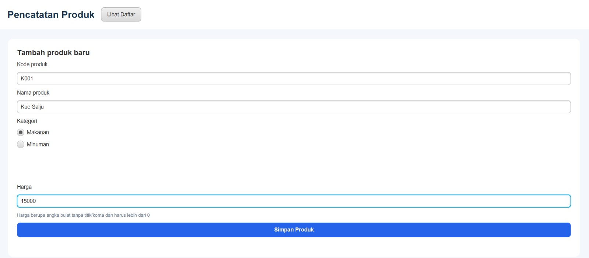
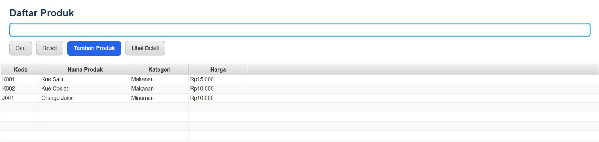
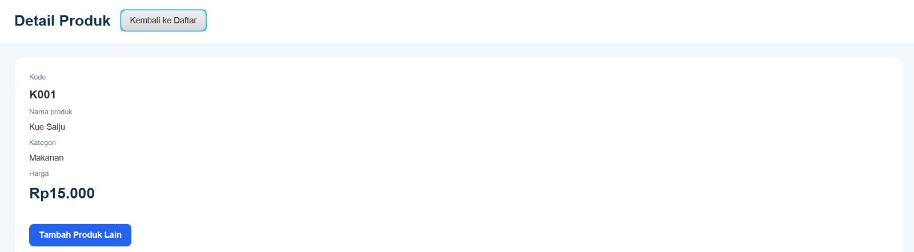

# Aplikasi Pencatatan Produk Toko (JavaFX)

Tugas individu: modifikasi aplikasi praktikum TiketApp menjadi aplikasi pencatatan produk toko.

Nama: Aflah Rusyda Ardian
NIM: 2509613

## Fitur
- Form tambah produk (kode diketik manual, nama, kategori Makanan/Minuman, harga)
- Validasi: kode dan nama tidak boleh kosong, kode tidak boleh kembar, harga harus lebih dari nol
- Tabel daftar produk (kode, nama, kategori, harga)
- Pencarian berdasarkan nama produk lewat tombol Cari
- Halaman detail yang menerima objek Produk yang dipilih
- Data disimpan selama aplikasi berjalan (tanpa database)

## Cara menjalankan
Prasyarat: JDK 17 atau lebih baru dan Maven. Internet diperlukan saat pertama kali untuk mengunduh dependensi JavaFX.

1. Clone repositori ini, lalu masuk ke foldernya:
   ```
   git clone https://github.com/aflahrusyda02/tugas-toko-javafx
   cd tugas-toko-javafx
   ```
2. Jalankan:
   ```
   mvn clean javafx:run
   ```
   Atau buka project di NetBeans, lalu klik kanan project dan pilih Run.

## Screenshot

### Form tambah produk





### Daftar produk





### Detail produk


